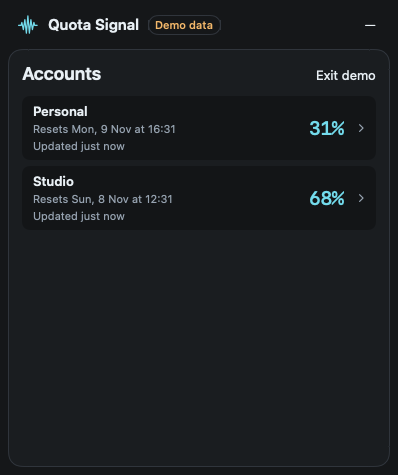
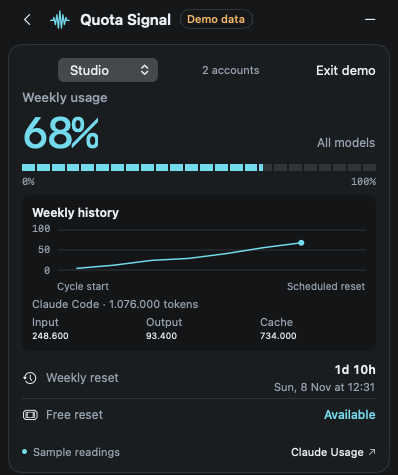

# Quota Signal

A native macOS menu bar app and floating dashboard for Claude weekly usage. See which connected workspace has the most quota left, when each resets, and how much usage your attributable local Claude Code logs recorded.

[Download Quota Signal for macOS](https://github.com/spkcd/quota-signal/releases/latest)

| Accounts dashboard | Account details |
| --- | --- |
|  |  |

Both screenshots use built-in fictional accounts and sample token counts.

## Install and start at login

1. Download and unzip `Quota-Signal-macOS-universal.zip` from the latest release.
2. Move **Quota Signal.app** to **Applications** and open it. Requires macOS 14 or newer and supports Apple silicon and Intel.
3. This preview build is ad hoc signed and has no Apple notarization ticket. If Gatekeeper blocks the first launch, review the source or build locally. To open the downloaded copy, use the per-app **Open Anyway** control under **System Settings → Privacy & Security** if macOS offers it.
4. Right-click the Quota Signal menu bar item and choose **Launch at Login**. If macOS requests approval, open **System Settings → General → Login Items & Extensions** and approve Quota Signal. The checked menu item means registration is enabled. Choose it again to turn it off.

Click the menu bar item to open the dashboard. Right-click for commands, including **Hide widget**, **Toggle demo data**, and **Quit Quota Signal**. Drag the widget header to move it.

## Connect Claude in Chrome

1. Right-click the menu bar item and choose **Set Up Chrome Companion…**. The app prepares the unpacked extension and registers its local native messaging host, then reveals the folder in Finder.
2. In the Chrome profile you use for Claude, open `chrome://extensions`. Turn on **Developer mode**, click **Load unpacked**, and select the **Chrome Companion** folder revealed in Finder.
3. Click **+** in Quota Signal. Leave the setup tab open and sign in to Claude in the same Chrome profile. The setup page adds the workspace when it can verify the account and read its weekly meter.
4. For simultaneous refreshes, repeat the extension setup in each dedicated Chrome profile. Use one active Claude workspace per profile, and start the pairing tab from the profile you want to connect. Keep Chrome running. Click the extension icon to retry a refresh and hover over it for the last result.

The companion attempts a refresh about every five minutes while Chrome is running and signed in. It uses a temporary background tab and sends only the reading, account identity, and reset information to the local app. Refresh depends on access to the Claude Usage page and its current layout. An old reading is marked stale after 15 minutes and falls below fresh accounts. The menu bar ranks fresh readings by percentage remaining.

## Claude Code and manual readings

- **Manual entry.** Right-click **+**, choose **Add manually**, and enter the weekly percentage and reset shown in Claude Usage.
- **Claude Code status line.** In the account editor, copy its status-line command. Put it in the profile's `statusLine.command` setting. If you already have a status-line script, call the copied command from it with the same input and discard the command's output. Keep each account command associated with its matching Claude Code profile. Recopy the command if you move the app.
- **Local token counts.** The app checks local Claude Code logs about every five minutes. It matches recorded session owner IDs to Claude Code account metadata, deduplicates streaming samples, and counts input, output, and cache tokens in the account's weekly quota window. Cache includes reads and writes. These are attributable local tokens. Claude's quota percentage is reported separately.
- **Account ID needed.** Quota Signal has not found a Claude Code ID mapped to the account's email. Sign in to Claude Code with that email and let Quota Signal rescan.
- **No attributable logs this week.** The ID is linked, but the scan found no eligible local token records for the current window.

For more detail, see the [usage and troubleshooting guide](docs/USAGE.md), [Claude Code status-line documentation](https://code.claude.com/docs/en/statusline), and [product roadmap](ROADMAP.md).

## Build from source

Install Apple's Command Line Tools, then run:

```sh
./build.sh
open ".build/Quota Signal.app"
```

Use `./build.sh --universal` for both architectures. To reproduce the sample screenshots:

```sh
".build/Quota Signal.app/Contents/MacOS/QuotaSignal" --demo --snapshot "$PWD/docs/screenshots/dashboard.png"
".build/Quota Signal.app/Contents/MacOS/QuotaSignal" --demo --demo-detail --snapshot "$PWD/docs/screenshots/account-detail.png"
```

Quota Signal is an independent app. It stores readings and account links on your Mac and has no hosted backend. The Chrome extension runs against Claude's website, and the optional embedded browser uses a separate session.
